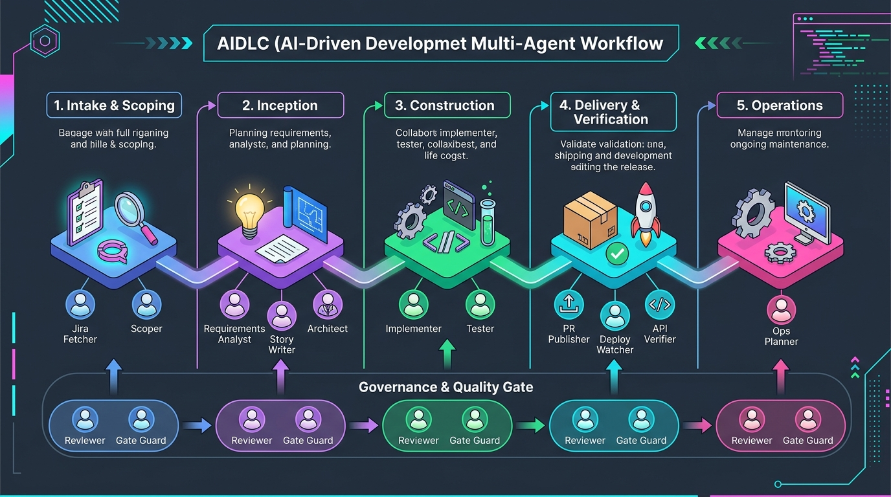
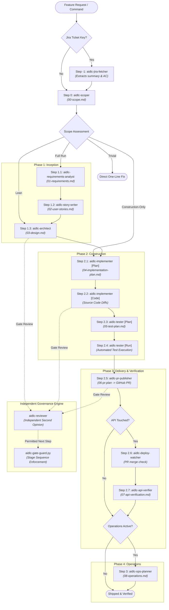

# AIDLC Claude Plugin

> **AI-Driven Development Life Cycle (AIDLC)** orchestrator and engineering skills suite: multi-agent staged workflows, architecture design, software testing, automated code reviews, PR publishing, and dev deployment verification.

---

## Overview

The **AIDLC Plugin** coordinates a team of 12 specialized subagents through structured, gated software engineering phases. Rather than running a monolithic prompt, AIDLC enforces:

- **Isolated Context Windows**: Each subagent receives its own context, preventing token bloat and context poisoning.
- **Principle of Least Privilege**: Agents have strictly bounded tool access (e.g., reviewers cannot edit files; planners cannot run mutating shell commands).
- **Hard Gate Enforcement**: Mechanical sequencing enforced by a `PreToolUse` hook ([hooks/aidlc-gate-guard.py](file:///c:/Users/HarjinderSingh1/Project/aidlc-claude-plugin/hooks/aidlc-gate-guard.py)) backed by persistent state in `aidlc-docs/<feature-slug>/.gate-state.json`.
- **Independent LLM Review & Human Approval**: High-risk milestones require independent audit verdicts from `aidlc-reviewer` and explicit human sign-off before downstream stages unlock.

---

## Lifecycle Flow & Execution Sequence





---

## Agent Inventory & Matrix

| Step | Agent | Phase | Stage Tag | Tools | Model | Consumes | Produces |
| :--- | :--- | :--- | :--- | :--- | :--- | :--- | :--- |
| **-1** | [aidlc-jira-fetcher](file:///c:/Users/HarjinderSingh1/Project/aidlc-claude-plugin/agents/aidlc-jira-fetcher.md) | Intake | *(None)* | `Read, mcp__atlassian` | `haiku` | Jira ticket key | Restated request |
| **0** | [aidlc-scoper](file:///c:/Users/HarjinderSingh1/Project/aidlc-claude-plugin/agents/aidlc-scoper.md) | Scoping | `00-scope` | `Read, Grep, Glob, Write, Bash` | `haiku` | Restated request | `00-scope.md` |
| **1.1** | [aidlc-requirements-analyst](file:///c:/Users/HarjinderSingh1/Project/aidlc-claude-plugin/agents/aidlc-requirements-analyst.md) | Inception | `01-requirements` | `Read, Grep, Glob, Write, Edit` | `sonnet` | `00-scope.md` | `01-requirements.md` |
| **1.2** | [aidlc-story-writer](file:///c:/Users/HarjinderSingh1/Project/aidlc-claude-plugin/agents/aidlc-story-writer.md) | Inception | `02-user-stories` | `Read, Write, Edit` | `haiku` | `01-requirements.md` | `02-user-stories.md` |
| **1.3** | [aidlc-architect](file:///c:/Users/HarjinderSingh1/Project/aidlc-claude-plugin/agents/aidlc-architect.md) | Inception | `03-design` | `Read, Grep, Glob, Write, Edit, Bash, mcp__postgres` | `sonnet` | `01-requirements.md`, `02-user-stories.md` | `03-design.md` |
| **2.1** | [aidlc-implementer](file:///c:/Users/HarjinderSingh1/Project/aidlc-claude-plugin/agents/aidlc-implementer.md) | Construction | `04-implementation-plan` | `Read, Write, Edit, Bash, Grep, Glob, mcp__postgres` | `sonnet` | `03-design.md` | `04-implementation-plan.md` |
| **2.2** | [aidlc-implementer](file:///c:/Users/HarjinderSingh1/Project/aidlc-claude-plugin/agents/aidlc-implementer.md) | Construction | `04-implementation-code` | *(Same as above)* | `sonnet` | `04-implementation-plan.md` | Code changes & migrations |
| **2.3** | [aidlc-tester](file:///c:/Users/HarjinderSingh1/Project/aidlc-claude-plugin/agents/aidlc-tester.md) | Construction | `05-test-plan` | `Read, Write, Edit, Bash, Grep, Glob` | `sonnet` | Code diffs, `02-user-stories.md` | `05-test-plan.md` |
| **2.4** | [aidlc-tester](file:///c:/Users/HarjinderSingh1/Project/aidlc-claude-plugin/agents/aidlc-tester.md) | Construction | `05-test-results` | *(Same as above)* | `sonnet` | `05-test-plan.md` | Test execution results |
| **2.5** | [aidlc-pr-publisher](file:///c:/Users/HarjinderSingh1/Project/aidlc-claude-plugin/agents/aidlc-pr-publisher.md) | Delivery | `06-pr-plan` | `Read, Bash, Grep, Glob` | `sonnet` | `00-scope.md`, `04-plan.md`, `05-plan.md`, git diff | GitHub branch & PR |
| **2.6** | [aidlc-deploy-watcher](file:///c:/Users/HarjinderSingh1/Project/aidlc-claude-plugin/agents/aidlc-deploy-watcher.md) | Verification | *(None)* | `Bash, Read` | `haiku` | PR number / branch | Merge verification |
| **2.7** | [aidlc-api-verifier](file:///c:/Users/HarjinderSingh1/Project/aidlc-claude-plugin/agents/aidlc-api-verifier.md) | Verification | `07-api-verification` | `Read, Grep, Glob, Bash, Write, Edit, mcp__postman` | `sonnet` | Dev URL, auth token, diff | `07-api-verification.md` |
| **3** | [aidlc-ops-planner](file:///c:/Users/HarjinderSingh1/Project/aidlc-claude-plugin/agents/aidlc-ops-planner.md) | Operations | `08-operations` | `Read, Grep, Glob, Bash, Write` | `sonnet` | `00-scope.md`, `03-design.md`, CI/CD files | `08-operations.md` |
| **Audit** | [aidlc-reviewer](file:///c:/Users/HarjinderSingh1/Project/aidlc-claude-plugin/agents/aidlc-reviewer.md) | Governance | *(All Gates)* | `Read, Grep, Glob, Bash` | `sonnet` | Target stage artifact & inputs | Audit verdict & critique |

---

## Agent Grouping Taxonomies

### 1. By SDLC Lifecycle Phase (Pipeline Sequence)
- **Intake & Scoping**: `aidlc-jira-fetcher`, `aidlc-scoper`
- **Inception (Analysis & Design)**: `aidlc-requirements-analyst`, `aidlc-story-writer`, `aidlc-architect`
- **Construction (Engineering & Testing)**: `aidlc-implementer`, `aidlc-tester`
- **Delivery & Verification**: `aidlc-pr-publisher`, `aidlc-deploy-watcher`, `aidlc-api-verifier`
- **Operations**: `aidlc-ops-planner`
- **Quality Governance**: `aidlc-reviewer`

### 2. By Functional Archetype & Permissions
- **Analytical Planners** *(Read, Grep, Glob, Write documentation only)*:
  `aidlc-requirements-analyst`, `aidlc-story-writer`, `aidlc-ops-planner`
- **System Builders** *(Read, Write, Edit, Bash)*:
  `aidlc-implementer`, `aidlc-tester`
- **External Integrators & MCP Gateways**:
  `aidlc-jira-fetcher` (Atlassian MCP), `aidlc-architect` (Postgres MCP), `aidlc-api-verifier` (Postman MCP), `aidlc-pr-publisher` (GitHub CLI)
- **Auditors & Monitors** *(Strictly read-only / non-mutating)*:
  `aidlc-reviewer` (No Write/Edit), `aidlc-deploy-watcher` (Read-only `gh` CLI)

### 3. By Cost & Model Tier (Token Economics)
- **Fast / Lightweight (`haiku`)**:
  `aidlc-jira-fetcher`, `aidlc-scoper`, `aidlc-story-writer`, `aidlc-deploy-watcher`
- **Deep Reasoning & Code Synthesis (`sonnet`)**:
  `aidlc-requirements-analyst`, `aidlc-architect`, `aidlc-implementer`, `aidlc-tester`, `aidlc-reviewer`, `aidlc-pr-publisher`, `aidlc-api-verifier`, `aidlc-ops-planner`

---

## Governance, Gates, and Safety

### Output Contract Protocol
All 12 agents strictly adhere to the context hygiene contract: full artifacts are persisted to `aidlc-docs/<feature-slug>/`, and only a standardized status block is returned:
```
STATUS: COMPLETED | BLOCKED | NEEDS_INPUT

Summary:
- 3-5 concise bullets summarizing deliverables, key decisions, or open questions
```

### Stage Sequencing Hook (`hooks/aidlc-gate-guard.py`)
- Every subagent call to a stage-producing agent must start with `[STAGE:<feature-slug>:<stage-id>]`.
- The hook verifies that the requested stage is the valid successor to `last_approved_stage` recorded in `aidlc-docs/<feature-slug>/.gate-state.json`.
- Disabling review (`--no-review`) or human overrides (`--human-reviewed`) are recorded in `.gate-state.json` and honored by the hook.

### Circuit Breakers
- **Revision Circuit Breaker**: If `aidlc-reviewer` returns "needs changes" twice on the same stage, automated re-delegation halts immediately to solicit human intervention.

### Standalone Execution & Direct Dev Mode
- For direct task execution without the full 9-stage ceremony, prompts starting with `[STANDALONE]` (e.g. `[STANDALONE:dev]`, `[STANDALONE:test]`) bypass sequential gate checks.
- For complex development tasks, `aidlc-implementer` automatically plans first, pauses for human sign-off, and implements code upon approval.
- For test generation, `aidlc-tester` formulates a test coverage matrix, pauses for review, and writes/executes tests.

---

## Slash Commands

| Command | Purpose |
| :--- | :--- |
| `/aidlc <request>` | Run the full end-to-end multi-agent workflow. |
| `/aidlc:scope <request>` | Run intake and scoping only (`00-scope.md`). |
| `/aidlc:design <slug>` | Run Inception: requirements, user stories, and architecture design. |
| `/aidlc:build <slug>` | Run Construction: implementation planning, coding, and testing. |
| `/aidlc:dev <task>` | **Direct Development**: Plans complex tasks, obtains approval, and writes code. |
| `/aidlc:test <target>` | **Direct Testing**: Plans test coverage, obtains approval, and executes tests. |
| `/aidlc:review <target>` | Run standalone `aidlc-reviewer` on an artifact, stage, or git diff. |

---

## Testing & Integrity Verification

Run the test suite using Python `unittest`:

```powershell
python -m unittest discover tests
```

Tests verify:
- Frontmatter integrity, model definitions, and tool bindings across all agents ([tests/test_agent_contracts.py](file:///c:/Users/HarjinderSingh1/Project/aidlc-claude-plugin/tests/test_agent_contracts.py)).
- PreToolUse gate guard sequence rules and permission decisions ([tests/test_gate_guard.py](file:///c:/Users/HarjinderSingh1/Project/aidlc-claude-plugin/tests/test_gate_guard.py)).
